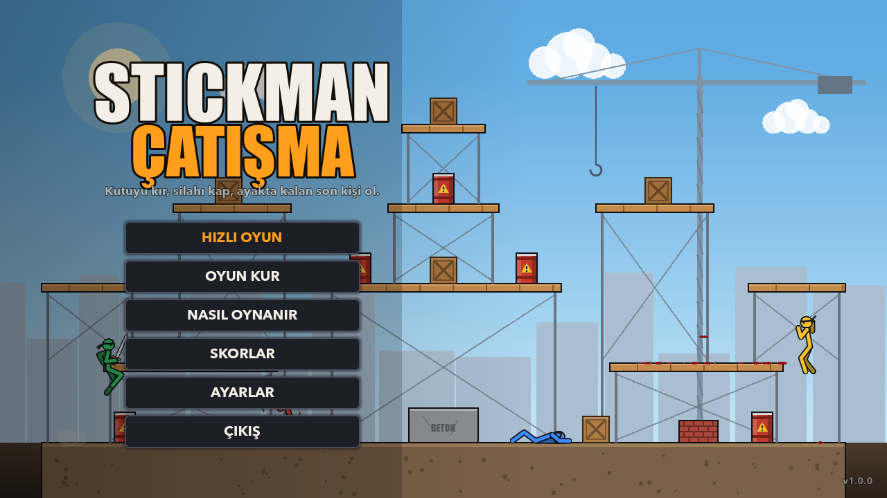
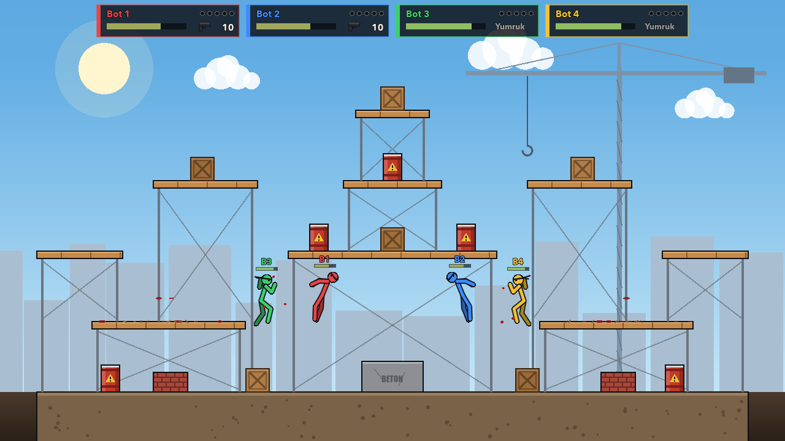
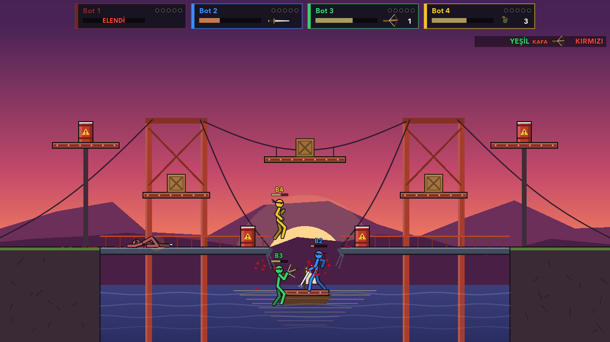
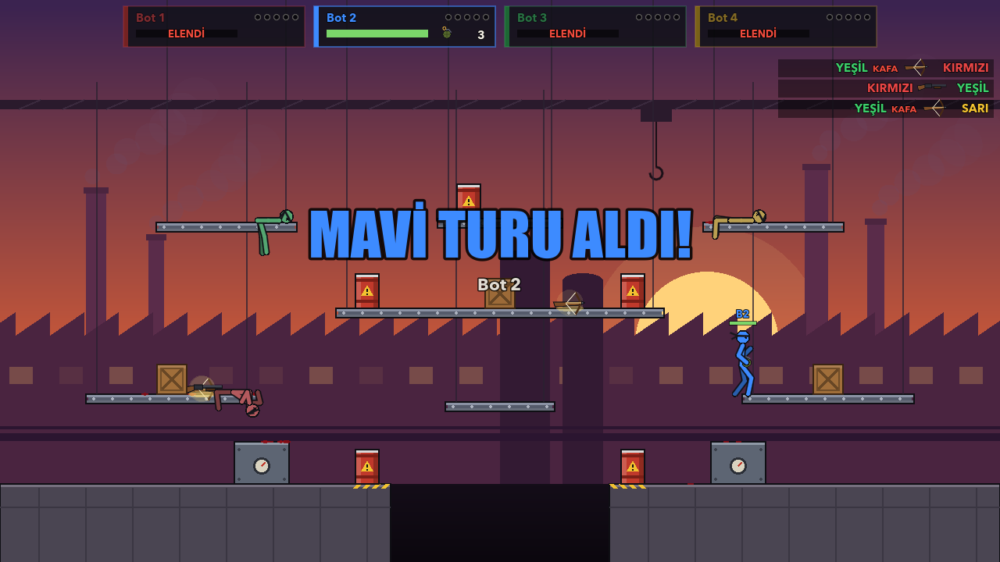
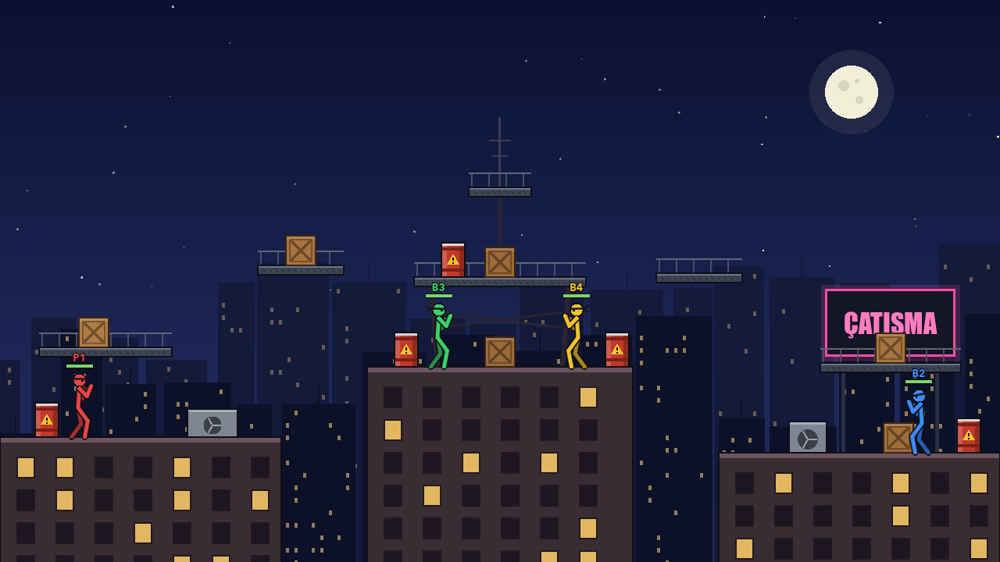
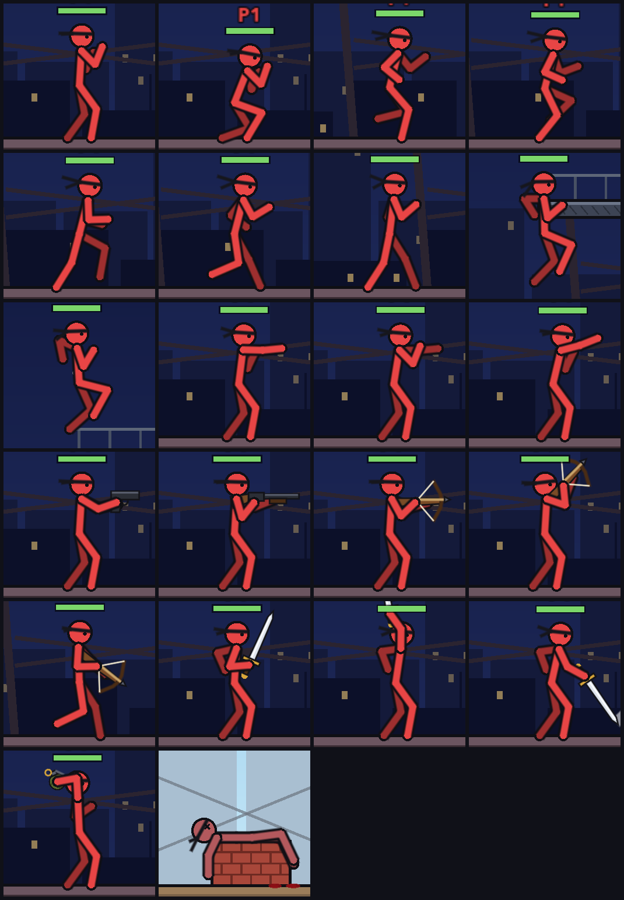

# Stickman Çatışma

Platformlarda geçen, 2–4 kişilik bir stickman dövüş oyunu. Herkes silahsız başlar: tahta kutuları yumrukla kırıp içinden çıkan silahı kap, kırmızı varillere ateş edip patlat, ayakta kalan son kişi ol.



| | |
|---|---|
|  |  |
|  |  |

## İndir ve oyna

En son sürüm: **[Releases](https://github.com/eminvergil/stickman-catisma/releases/latest)**

| Sistem | Dosya | Çalıştırma |
|---|---|---|
| Windows | `StickmanCatisma-windows.zip` | Zip'i aç, `StickmanCatisma.exe`'yi çalıştır. SmartScreen uyarısında *Ek bilgi → Yine de çalıştır*. |
| macOS (Intel + Apple Silicon) | `StickmanCatisma-macos.zip` | Zip'i aç, `Stickman Catisma.app`'i Uygulamalar'a taşı. İlk açılışta sağ tık → *Aç*. "Hasarlı" uyarısı çıkarsa: `xattr -cr "/Applications/Stickman Catisma.app"` |
| Linux (x86_64) | `StickmanCatisma-linux.zip` | Zip'i aç, `./StickmanCatisma.x86_64` |

Uygulama imzasız olduğu için ilk açılışta işletim sistemi uyarı verebilir.

## Oynanış

- **Silahsız başlarsın.** Yumruk üç vuruşluk bir kombodur; sonuncusu rakibi savurur.
- **Tahta kutular** yumrukla ya da herhangi bir silahla kırılır ve içinden rastgele bir silah çıkar. Turda gökten yeni kutular düşer.
- **Kırmızı variller** vurulunca patlar: yakındakileri savurur, kutuları kırar, diğer varilleri de tutuşturur.
- Sert bir darbe ya da patlama stickman'i **yere serer** (ragdoll); hayatta kalırsa kalkıp savaşmaya devam eder.
- Haritanın dışına düşen elenir. Son vuranın hanesine leş yazılır.
- 75 saniyeyi geçen turlarda **ani ölüm** başlar: gökten yanan variller yağar.

### Silahlar

| Silah | Özellik |
|---|---|
| Tabanca | 10 mermi, hızlı ve isabetli. Kafaya gelen mermi daha çok acıtır. |
| Pompalı | 5 fişek, yakında yıkıcı, uzakta zayıf. Geri tepmesi seni de iter. |
| Arbalet | 4 ok, ağır hasar ve büyük itme. Ok süzülerek düşer. |
| Kılıç | Sınırsız. Doğru anda savurursan mermileri geri sektirir. |
| El bombası | 3 tane. Kavisli fırlatılır, sekerek 2 saniye sonra patlar. |

Mermisi biten silahla ateş edersen silahı rakibe fırlatırsın.

### Kontroller

| | Klavye 1 | Klavye 2 | Gamepad |
|---|---|---|---|
| Koş | A / D | ← / → | Sol çubuk |
| Zıpla | W / Boşluk | ↑ | A |
| Eğil · platformdan in (↓ + zıpla) | S | ↓ | Aşağı |
| Saldır · ateş | Sol tık / F | Enter | X / RT |
| Silahı fırlat | Sağ tık / G | Sağ Shift | B |
| Nişan | Fare | Otomatik | Sağ çubuk |
| Duraklat | Esc / P | Esc / P | Start |

Klavyeyle (fare olmadan) oynarken silah öndeki rakibe, yoksa yakındaki kutu ya da varile kendiliğinden yönelir.

## Özellikler

- **İnsan gibi hareket eden stickman'ler:** iskelet tamamen prosedürel. Yürüme döngüsü kat edilen mesafeyle ilerlediği için basan ayak kaymaz; dizler ve dirsekler iki kemikli IK ile çözülür, gövde hıza göre öne eğilir, koşarken kollar ters salınır, inişte dizler yükü alır. Ölünce ya da patlamayla savrulunca vücut verlet tabanlı bir ragdoll'a dönüşür, yerde kalanlar ayağa kalkarken ragdoll pozundan yumuşakça toparlanır.
- 4 harita: **Fabrika**, **Çatılar**, **İnşaat**, **Köprü**
- 4 oyuncuya kadar: aynı klavyede iki kişi, gamepad'ler ve üç zorlukta botlar (kutu kırar, silah toplar, varilleri patlatır, el bombasından kaçar, mermiden zıplayarak kaçınır)
- Ana menünün arkasında botlar gerçek bir maç oynar
- Skorlar (silaha göre leş, kafadan vuruş, kırılan kutu, patlatılan varil, son maçlar) ve ayarlar kaydedilir
- Tüm sesler ve müzik açılışta sentezlenir; projede hiç ses ya da resim dosyası yoktur



## Kaynaktan çalıştırma

[Godot 4.7](https://godotengine.org/download) ile:

```bash
godot --path .
```

Testler (başsız):

```bash
godot --headless --path . res://tests/test_sim.tscn
godot --headless --path . res://tests/test_ui.tscn
```

`test_sim` fizik, IK, yürüyüş döngüsü, silahlar, varil zincirleri, ragdoll, navigasyon ve 12 tam bot maçını; `test_ui` menüden maç sonuna kadar ekran akışını dener. `tests/shots.tscn` animasyon pozlarının ve haritaların ekran görüntülerini üretir.

### Proje yapısı

```
scripts/
  autoload/   settings, scores, sfx (ses sentezi), match
  game/       world (simülasyon), stickman, rig (animasyon + IK + ragdoll), weapons,
              levels, nav + ai (botlar), controls, world_view (çizim), game_screen (HUD)
  screens/    menü, oyun kur, nasıl oynanır, ayarlar, skorlar
tests/        test_sim, test_ui, shots
```

Simülasyon 120 Hz sabit adımla çalışır ve ekranlardan bağımsızdır; botlar insan oyuncularla aynı girdi sözlüğünü üretir.

## Sürüm yayınlama

`v*` etiketi gönderildiğinde GitHub Actions testleri çalıştırır, Windows, macOS ve Linux sürümlerini derler ve Release'e ekler:

```bash
git tag v1.0.1 && git push origin v1.0.1
```

## Lisans

[MIT](LICENSE)
